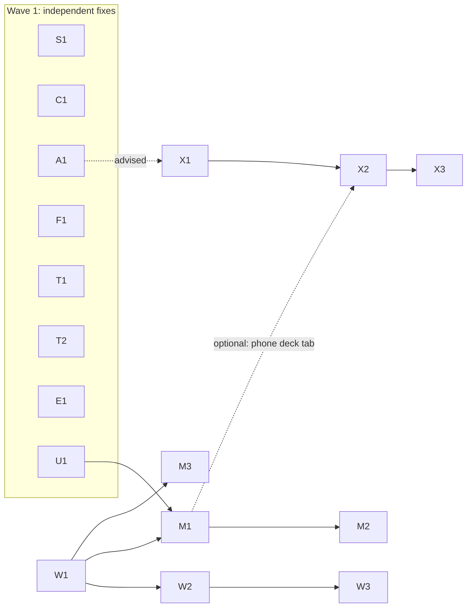

# Upstream migration plan: 4C-Winterberg-e-V/liveplay → tdoukinitsas/liveplay

**Goal:** get the fork's functionality into the original repository
([tdoukinitsas/liveplay](https://github.com/tdoukinitsas/liveplay)) as a series
of focused pull requests. The aim is to keep **all** the fork's functionality
while merging as little code as practical, and to use upstream's own
implementation wherever it already exists.

**Audience:** a coding agent (or person) executing the work one package at a
time. Read this file completely once. Then, for each package, read only
`packages/<ID>-*.md`.

State analysed: upstream `main` @ `6295947` (v2.5.1, 2026-10-06), fork `main` @
`36e80e7` (fork-internal 2.6.1, 2026-08-09), common ancestor `3c3d27c`
(upstream v2.4.3). Re-check both refs before starting (§5.1). If upstream has
moved, the line numbers in the package files will drift; function names and
search strings stay valid.

---

## 1. Summary

| | Upstream since v2.4.3 | Fork since v2.4.3 |
|---|---|---|
| Commits | 229 | 113 (+20 merges) |
| Size | +77.8k / −14.3k lines, 271 files | ~13.6k lines of code (excl. lockfiles, docs, locales) |
| Themes | bus/mixer architecture with DSP, logical output map; settings registry + settings page (deleted the settings/controls/about/server modals); opt-in accounts, tokens, fs allow-list, CORS/WS origin policy; workspace pane model; per-user prefs; tray mode; i18n rebuilt (458 → 974 strings); API catalog; ~35 e2e suites | X18 desk control; touch-first phone UI + PWA; browser renderer + in-app web sharing (LAN / Cloudflare tunnel, PIN); per-cue output channels; server fs sandbox; audit fixes; pnpm, doctest, Vitest, CI |

A trial merge of upstream into the fork conflicts in **56 files**. The worst are
`project_state.cpp` (20 hunks), `MainWorkspace.vue`, `PropertiesPanel.vue`,
`control_server.cpp`, all 21 locales, plus three modals upstream deleted.
**Merging is the wrong tool.** Upstream rewrote exactly the areas the fork
touched, so the fork's changes must be **ported onto upstream's new structure**
in reviewable pieces.

Details: [Appendix A — what upstream changed](appendix-upstream-changes.md),
[Appendix B — every fork commit → package](appendix-commit-map.md).

## 2. Decisions per fork feature

| Fork feature | Verdict | Package(s) |
|---|---|---|
| X18 desk control: per-cue actions, board, two-way levels | **Port** (net-new upstream) | X1, X2, X3 |
| Browser renderer (same-origin server, bundled locales, Electron-only controls hidden) | **Port** (upstream is Electron-only) | W1 |
| In-app web sharing, LAN + PIN | **Port + harden** (the fork's own review found the issues) | W2 |
| Cloudflare quick/named tunnel | **Port if the maintainer agrees**, else fork-only | W3 |
| Phone layout (deck tabs, bottom transport, sheets) | **Re-implement** on upstream's workspace model, using the fork as the spec | M1 |
| Touch controls (Pointer Events, rows, cart pads, seek) | **Re-implement** | M2 |
| PWA | **Port** | M3 |
| Per-cue hardware output channels | **Superseded** by buses + logical output map. One engine gap remains: devices are opened as stereo, so outputs above 1/2 are silent | A1 |
| Server filesystem sandbox | **Superseded** by upstream's opt-in allow-list (configure `fsRoots`). Gap: dialog imports outside the roots | F1 (+E1) |
| Audit fixes, server | 4 still needed; atomic save and LTC already fixed upstream | S1 |
| Audit fixes, client | 2 still needed; 3 fixed or obsolete upstream | C1 |
| Small UX (Stop All armed, in-app delete confirm, per-device Show Mode, resume prompt, slider) | **Port**. Show Mode is redesigned as an opt-out rather than deleting upstream's sync | U1 |
| Electron: Edit menu, dialog start folder, software rendering | **Port** | E1 |
| Dev loop: rebuild stale server; CI: run ctest, Node 22 | **Port** | T1, T2 |
| `BUILD_TARGET=web` SPA build, CORS-simple requests | **Drop.** Sharing serves the normal build, and upstream answers preflights (#62) | — |
| pnpm, doctest, Vitest, vue-tsc gate | **Drop.** Use upstream's npm and test style; tests are converted inside each package | (optional T3) |
| Dependency security bumps | **Optional**: re-evaluate against upstream's current `npm audit` (51 findings on v2.5.1) | (optional T4) |
| Fork README, German docs, CODE_REVIEW.md, version bumps, auto-updater → fork | **Fork-only**, never upstream | §7 |

## 3. Package list and order

| ID | Package | Depends on | Size | Upstream acceptance risk |
|---|---|---|---|---|
| [S1](packages/S1-server-robustness.md) | Server robustness: recursion bound, broadcast lifetime, repair on replace, media guards | — | S | low |
| [C1](packages/C1-client-sync-robustness.md) | Client: subscription leak, item-sync retry | — | S | low |
| [A1](packages/A1-native-device-channels.md) | Open devices with native channel count | — | S | low-med |
| [F1](packages/F1-import-upload-fallback.md) | Upload fallback when the allow-list refuses a picked path | — | XS | low |
| [T1](packages/T1-dev-loop-rebuild.md) | `npm run dev` rebuilds a stale server | — | XS | low |
| [T2](packages/T2-ci-unit-tests-node22.md) | CI runs ctest; Node 22 | — | XS | low |
| [E1](packages/E1-electron-papercuts.md) | Edit menu, dialog start folder, software rendering | — | S | low |
| [U1](packages/U1-ux-papercuts.md) | Stop All, delete dialog, Show Mode opt-out, resume, slider | — | S | low-med |
| [W1](packages/W1-browser-renderer.md) | Renderer works in a browser | — | M | med |
| [W2](packages/W2-lan-web-sharing.md) | LAN sharing + PIN (hardened) | W1 | L | med-high |
| [W3](packages/W3-cloudflare-tunnel.md) | Cloudflare tunnel | W2 | M | **high** |
| [M1](packages/M1-phone-layout.md) | Phone layout shell | W1, U1 | **XL** | med |
| [M2](packages/M2-touch-controls.md) | Touch controls | M1 | L | med |
| [M3](packages/M3-pwa.md) | PWA | W1 | S | low-med |
| [X1](packages/X1-x18-core.md) | X18 link + per-cue actions | (A1 advised) | L | med-high |
| [X2](packages/X2-x18-board.md) | X18 board pane | X1 | M | med |
| [X3](packages/X3-x18-levels.md) | X18 levels page | X2 | L | med |



**Order of submission:**

0. **Wave 0, coordination, before any code** (§4).
1. **Wave 1:** S1, C1, A1, T1, T2, E1, F1, U1. These are independent and small,
   and they build trust. Open them a few at a time, not all at once.
2. **Wave 2:** W1, then W2. W3 only after the maintainer agrees.
3. **Wave 3:** M1, then M2; M3 after W1.
4. **Wave 4:** X1, then X2, then X3. Wave 4 can run in parallel with waves 2-3.

**Effort guide** (one engineer-day ≈ one focused agent session including testing):
S/XS ≈ 0.5-1 day each, M ≈ 2 days, L ≈ 3-4 days, XL (M1) ≈ 5+ days. Total
≈ 30-40 days of work, plus review cycles. M1/M2 need the most judgement;
consider a stronger model or human review there.

## 4. Coordinate with upstream first (Wave 0)

Upstream merges contributor PRs into a release branch named `X.Y.Z-dev` (e.g.
PR #72 → `2.5.1-dev`) and merges that into `main` at release. It has no
CONTRIBUTING file or PR template. Before opening code PRs:

1. Open **one issue** on tdoukinitsas/liveplay: "Contributing features from the
   4C Winterberg fork". In it, briefly list the waves, link to this plan's
   package summaries, and ask:
   - which branch PRs should target (`main` or a current `*-dev`);
   - whether hardware-specific **X18** support is welcome in core;
   - whether **internet sharing via Cloudflare** (W3) is welcome, and whether
     the **PIN gate** should stay or upstream accounts should be required instead;
   - whether the **phone layout** direction (M1/M2) is welcome. Attach
     screenshots from the fork.
2. Adapt to the answers. A "no" for X18 or W3 means those packages stay
   fork-only (§7). They are self-contained, so that is cheap.
3. Reference the issue in every PR.

## 5. How to execute a package

### 5.1 One-time setup (in a clone of the fork)

```sh
git remote add upstream https://github.com/tdoukinitsas/liveplay.git   # if missing
git fetch upstream --tags && git fetch origin
git log -1 --format='%h %s' upstream/main      # compare with "State analysed" at the top of this file
```

Build prerequisites: see upstream `docs/DEVELOPMENT.md` (Node + npm, CMake ≥ 3.21,
C++20, vcpkg with `VCPKG_ROOT`, Ninja on macOS/Linux).

### 5.2 Branches

- Name: `up/<ID>-<slug>` exactly as in the package file, pushed to the **fork**.
- Base: the upstream target branch from §4 (default `upstream/main`):
  `git switch -c up/S1-server-robustness upstream/main`.
- **Stacked packages** (W2 on W1, M2 on M1, X2 on X1, …) branch from their
  dependency's branch until that is merged. When the dependency merges
  upstream, rebase the stacked branch onto the new upstream target branch
  before review starts. After review has started, **merge** upstream into the
  branch instead of rebasing (upstream uses merge commits).
- Open the PR from the fork branch against tdoukinitsas/liveplay. Mark stacked
  PRs as "Depends on #NN — review only the commits after …".

### 5.3 Rules that apply to every package

1. **Port, don't merge.** New files may be copied verbatim from the fork:
   `git show origin/main:<path> > <path>`. Files that **also exist upstream** are
   never taken wholesale. Apply the fork's intent onto upstream's version by hand.
2. **Never include:** version bumps (`package.json`, `client/package.json`,
   `docs-site/*`, `server/vcpkg.json`; release CI fires on root version changes),
   pnpm files, `CODE_REVIEW.md`, German docs, the fork README, the fork's
   auto-updater/publish owner, deploy kits, `docs/upstream-migration/`.
3. **npm only.** Add dependencies with `npm install --workspace client <pkg>@<range>`
   and commit only the resulting `package-lock.json` change. Never regenerate
   the whole lockfile.
4. **English only** in code, comments, logs, docs and commit messages. Translate
   any German left in ported files.
5. **Upstream conventions** (read upstream `docs/OWNERSHIP_MODEL.md`,
   `docs/DEVELOPMENT.md`):
   - New **project settings** keys must be registered in `settings_registry()`
     (`server/src/core/project_state.cpp`). Unknown keys are silently dropped.
   - Decide where state lives by the ownership model: project document, server
     (`liveplay.json`, `outputs.json`, `users.json`), user prefs, machine
     (`localStorage`/`userData`) or session.
   - Every new HTTP route, WS command, server frame or `doc_patch` op must be
     added to `docs-site/public/api/reference.json`.
     `node docs-site/scripts/check-api-reference.mjs` must pass.
   - Settings UI goes into a `SettingsPane*.vue` registered in
     `useSettingsPage.ts` (`SETTINGS_SECTIONS`) and `SettingsPage.vue`. Run
     `node client/tests/settings-form-placement-tests.js`.
   - Workspace UI goes into the pane model (`useWorkspaceLayout.ts`,
     `MainWorkspace.vue`, `WorkspaceBar.vue`, `PaneControls.vue`).
6. **i18n rule:** add new strings to `client/locales/en.json` (English) and
   `de.json` (German, from the fork) **at the end of the relevant object**.
   Then run `node scripts/sync-locale-keys.js`, which copies missing keys into
   the other 19 locales in English (upstream's `t()` also falls back to
   English). Never hand-edit the other locales, and never reformat them. Files
   are 2-space JSON with a trailing newline. Say in the PR that 19 locales
   carry English until translated, and offer translations.
7. **Tests in upstream style** (no doctest, no Vitest):
   - C++: one framework-free binary per area, registered in
     `server/CMakeLists.txt` inside `if(LIVEPLAY_BUILD_TESTS)` with
     `add_executable(liveplay-<area>-tests tests/<area>_test.cpp)` and
     `add_test(NAME <area> COMMAND liveplay-<area>-tests)`. Update the suite count
     in `docs/DEVELOPMENT.md`. Conversion from doctest:

     | doctest | upstream style |
     |---|---|
     | `#include <doctest/doctest.h>` | `static int g_failures = 0; static void check(const char* what, bool ok) { std::printf("%-60s %s\n", what, ok ? "PASS" : "FAIL"); if (!ok) ++g_failures; }` |
     | `TEST_CASE("name") { … }` | `static void test_name() { std::puts("-- name"); … }` |
     | `CHECK(expr)` / `CHECK_EQ(a,b)` | `check("expr", (expr));` / `check("a == b", (a) == (b));` |
     | `CHECK(x == doctest::Approx(y))` | `check("x ≈ y", std::fabs((x) - (y)) <= 1e-6);` (use the test's intended tolerance) |
     | `REQUIRE(expr)` | `if (!(expr)) { check("expr", false); return; }` |
     | `SUBCASE("s")` | its own `static void` function |
     | (doctest main) | `int main() { test_a(); …; return g_failures ? 1 : 0; }` |
   - Client logic: a node script `client/tests/<name>-tests.js` using
     `node:assert/strict`. Load TS with `typescript.transpileModule(...)` + `node:vm`,
     as `client/tests/mixer-regression-tests.js` does. Map
     `expect(a).toBe(b)` → `assert.equal`,
     `toEqual` → `assert.deepEqual(JSON.parse(JSON.stringify(a)), b)`,
     `toBeCloseTo` → a tolerance check, and `toThrow` → `assert.throws`.
     List the script under "Checks" in `docs/DEVELOPMENT.md`.
   - Server behaviour: an e2e script in `server/tests/e2e/`, registered in its README.
8. **Commits:** conventional prefix (`feat:`, `fix:`, `docs:`, `test:`,
   `i18n:`, `ci:`) plus a body that says *why*, as upstream's history does. One
   logical change per commit.
9. **Baseline verification for every PR** (in addition to the package's own list):
   ```sh
   npm ci
   cd server                                              # presets are read from the CWD
   cmake --preset default -DLIVEPLAY_BUILD_TESTS=ON       # Windows: --preset vs2022
   cmake --build --preset default                         # Windows: --preset vs2022
   ctest --test-dir build -C Release --output-on-failure
   cd ..
   npm run build:client
   node client/tests/window-bounds-tests.js && node client/tests/settings-form-placement-tests.js && node client/tests/mixer-regression-tests.js
   node docs-site/scripts/check-api-reference.mjs
   ```
   Then push to the fork and let the fork's Actions build the matrix before
   opening the upstream PR.
10. **PR description:** what and why (user-visible), how (key files), tests run
    (with OS), screenshots for UI, the link to the §4 issue, and dependencies.
    End with a note that it comes from the 4C Winterberg fork, where it has been
    used live.

## 6. Keep the club running while PRs are open: the integration branch

Upstream review will take weeks, and some packages may be refused. Keep a
fork build that has **upstream v2.5.1 + every package**:

1. `git switch -c fork/next upstream/main`.
2. For each package branch, in the order of §3, run `git merge --no-ff up/<ID>-…`.
   Conflicts between packages are expected only in `MainWorkspace.vue`,
   `ProjectHeader.vue`, `useProject.ts` and the locale files. Resolve them on
   `fork/next` only, never by changing the package branches.
3. Add the **fork-only** commits on top (§7.1).
4. Build, then run the §8 acceptance test **with real hardware** (X18, phones)
   before the next event.
5. Whenever upstream releases, merge `upstream/main` into `fork/next`, and drop
   packages that upstream has merged (they become no-ops).
6. When `fork/next` is proven at an event, make it the fork's `main`. Tag the
   old main first (`legacy/v2.6.1`; tag `v2.6.1` already exists). A repo admin
   then switches the default branch to `fork/next` or force-updates `main`.
   This is a decision for the repo owner, not the executing agent.

## 7. Fork-only items and the transition

### 7.1 Fork-only commits on `fork/next`

- **Version:** `2.5.1-4c.1`, `2.5.1-4c.2`, … (upstream version + suffix). This
  avoids the fork's 2.5.0/2.6.x colliding with upstream's numbers.
  electron-updater enables prereleases automatically when the running version
  has a suffix. Upstream's `scripts/version.js` accepts only `X.Y.Z`, so either
  edit the six files by hand or relax its regex in a fork-only commit.
- **Auto-updater and publish target → fork** (`b33d577`), so club installs keep
  updating from fork releases.
- **README:** keep a short fork notice on top of upstream's README: what the
  fork adds, the link to upstream, and which packages are pending.
- **pnpm:** dropped. The fork goes back to npm to match upstream; this makes
  every future sync conflict-free.
- Packages upstream refused (e.g. W3, X1-X3) stay as merges on `fork/next`.
- German docs / CODE_REVIEW.md: keep them in the fork under `docs/fork/` if
  still useful, or drop them. Never upstream.

### 7.2 Operator settings to redo once (club laptops)

| Fork setting | After migration |
|---|---|
| Server sandbox (automatic) | Settings → Server → `fsRoots`, or `liveplay.json` `"fsRoots": [absolute paths]`; restart. See F1 |
| Per-cue / default / preview **output channels** | Settings → Outputs: map logical outputs to the interface channels (e.g. `X18 5-6`); create buses targeting them; assign cues or groups to buses. Upstream migrates old `deviceOverride` items onto a bus named after the device, but the fork's channel pairs (`deviceOverrideChannels`, `defaultOutputChannels`, `previewChannels`, `ltcChannel`) are ignored, so remap them by hand. LTC: set the project's LTC output to a logical output. Needs A1 for channels above 1/2 |
| Web share PIN / auth / named tunnel | Unchanged: same files in Electron `userData` (`liveplay-webshare.json`, `liveplay-tunnel.json`) |
| X18 IP, board, faders, cue actions | Unchanged: same document keys (`settings.x18Ip`, `x18Board`, `settings.x18Faders`, item `x18Actions`) |
| Show Mode on phones | Phones open in Show Mode and no longer follow the desktop (M1/U1) |

## 8. End-to-end acceptance test (run on `fork/next`, and again on upstream after the last merge)

1. Desktop (macOS + Windows): open an existing fork show. Play, stop and let
   cues end naturally; groups, carts and auto-advance work.
2. Outputs: a cue routed via a bus to X18 USB 5/6 is heard **only** there.
3. X18: cue start/stop actions move the desk. The board buttons and their keys
   work. The levels page follows the physical faders both ways.
4. Sharing: LAN share plus PIN from a phone; the named tunnel from mobile data;
   the PIN lockout works.
5. Phone: deck tabs, bottom transport, Stop All always reachable, cart arm-then-fire,
   seek commits on release, faders by touch, installable over the tunnel.
6. Two clients: Show Mode independent per device; selection still syncs.
7. Kill the network for 5 s during edits: the edits arrive after reconnect (C1).
8. Server: start a cyclic start-behaviour pair through the API; the server survives (S1).

## 9. Open questions for the repository owner

1. Has the upstream maintainer been contacted, and are X18 (X1-X3), internet
   tunnels (W3) and the phone layout (M1/M2) welcome? (§4)
2. PR target branch: `main` or a `*-dev` branch?
3. Web sharing: keep the PIN gate (default here), or require upstream accounts instead?
4. X18 IP: project-tier (default here; fork shows load unchanged) or server-tier?
5. OK to drop pnpm in the fork (recommended)?
6. Who reviews M1/M2? Which phones and tablets, and which X18 or other multi-out
   interface, are available for testing?
7. Are there fork features in use that are not in Appendix B, such as local
   patches on club laptops?
